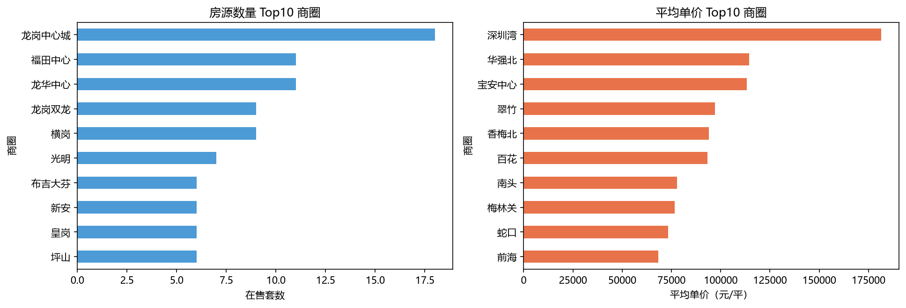
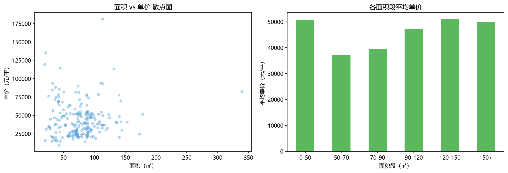
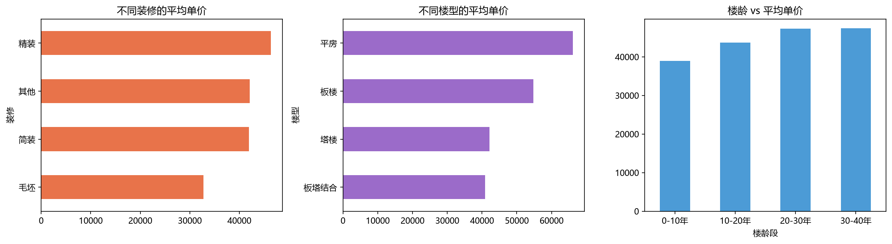

# 基于 Python 爬虫的深圳二手房房价影响因素分析

> 数据采集课程设计 · 链家网（深圳站）二手房数据采集与影响分析
> 采集 **220 条真实在售房源**，覆盖 **204 个小区、69 个商圈**，从请求到可视化全流程实现。

  

---

## 项目简介

本项目自主选取链家网深圳二手房列表页作为数据源，完整实现了一套 **采集 → 翻页 → 清洗 → 存储 → 查询 → 可视化** 的数据采集流程，并基于真实数据回答：**地段、面积、装修、楼龄对房价的影响有多大？**

链家具备成熟的反爬机制（人机验证页、访问限流、登录态页面结构差异），因此本项目同时也是一次完整的**反爬攻防实战**。

## 技术栈

| 环节 | 技术 |
|---|---|
| 请求采集 | requests（UA 伪装 + Cookie 注入 + 重试冷却） |
| 页面解析 | lxml + XPath（字典驱动的字段定位） |
| 反爬突破 | Selenium + Chrome（人工通过人机验证，脚本自动续爬） |
| 数据清洗 | pandas（正则 str.extract / 数值化 / 去重去空） |
| 可视化 | matplotlib |
| 数据存储 | CSV（utf-8-sig，Excel 直开不乱码） |

## 项目亮点

1. **反爬应对成体系**：UA 伪装 → 新鲜 Cookie 注入 → 限流冷却重试（实测约 2 分钟放行 1 页）→ Selenium 真实浏览器人工过验证后自动续爬，四层递进全部实战验证；
2. **登录态结构适配**：发现登录态下列表项 class 追加 `LOGVIEWDATA` 后缀导致精确匹配失效，改用 `contains()` 模糊匹配并过滤广告卡片；
3. **工程健壮性**：每页成功立即落盘（中断不丢数据）、按链接唯一键去重、单页失败自动跳过、请求超时保护；
4. **多标签难点**：一套房源可同时携带多个标签（如 `近地铁 | VR房源 | 随时看房`），以分隔符完整保留并支持标签查询；
5. **组合查询**：标题关键字 / 标签 / 商圈 / 价格面积区间任意组合，结果按单价排序渐变色输出；
6. **分析有洞察**：不止于画图，给出可解释的因果讨论。

## 分析结论（220 条样本）

| 维度 | 结论 |
|---|---|
| 地段 | 决定性因素：深圳湾 181,416 元/㎡ vs 布吉街 19,768 元/㎡，相差 **9.2 倍** |
| 面积 | 全市尺度与单价几乎无关（**r = 0.04**）——单价由地段主导；120~150㎡ 改善型段单价峰值 50,995 元/㎡ |
| 装修 | 精装比毛坯溢价 **13,637 元/㎡** |
| 楼龄 | 楼龄越老均价反而越高（40 年+ 段 47,422 元/㎡）——老房集中于市中心，印证**地段 > 楼龄** |
| 全市 | 单价中位数 38,161 元/㎡，均值 43,770 元/㎡（右偏分布，中位数更具代表性） |

| 房源数量与均价 Top10 商圈 | 面积 vs 单价 |
|---|---|
|  |  |



## 快速开始

```bash
# 1. 安装依赖（Python 3.9+，建议 3.10~3.13）
pip install -r requirements.txt

# 2. 获取 Cookie（二选一）
#    方式 A：Chrome 打开 https://sz.lianjia.com/ershoufang/
#            F12 → Network → 刷新 → 点第一条请求 → Request Headers → 复制整串 Cookie
#    方式 B：遇到限流时运行 notebook 的 Selenium 单元，真实浏览器中人工通过验证
# 3. 将 Cookie 填入 notebook 配置格的 COOKIE = '' 引号内
# 4. Jupyter 中自上而下运行 lianjia_spider_analysis.ipynb
```

> **安全提醒**：Cookie 等同于登录身份，任何提交/上传前必须清空（本仓库已清空）。请勿将真实 Cookie 上传到任何公开场合。

## 目录结构

```
shenzhen-lianjia-spider/
├── lianjia_spider_analysis.ipynb   # 完整项目：采集/翻页/清洗/图表/查询
├── data/
│   ├── lianjia_raw.csv             # 原始数据 220 条 × 9 字段
│   └── lianjia_clean.csv           # 清洗后 18 列（含楼龄、面积段）
├── charts/                         # 三组分析图表
├── requirements.txt
├── .gitignore
└── README.md
```

## 数据字典（清洗后核心字段）

| 字段 | 说明 | 字段 | 说明 |
|---|---|---|---|
| 小区 / 商圈 | 按 " - " 拆分 | 单价(元/平) | 去单位转 int |
| 户型 / 面积 / 朝向 | 按 ` \| ` 正则拆分 | 楼层位置 / 总楼层 | 正则抽取 |
| 装修 / 楼型 | 多选一匹配 | 建成年份 / 楼龄 | 正则 + 整列运算 |
| 标签 | 多标签 `\|` 拼接 | 关注人数 / 发布时间 | 正则 + 拆分 |

## 合规与免责声明

- 本项目仅用于**课程学习与技术练习**，数据版权归链家平台所有，请勿用于商业用途；
- 采集过程遵守爬虫礼仪：控制频率（每页间隔数秒）、失败冷却、只爬公开列表数据；
- 请遵守目标网站 robots 协议与当地法律法规。

## License

[MIT](LICENSE)
